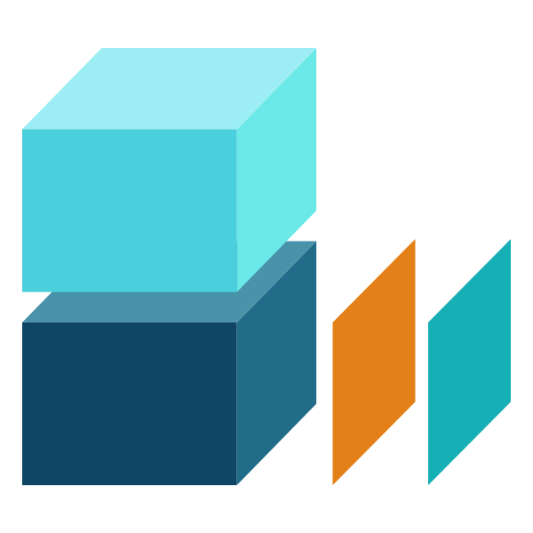

# DASCore


DASCore is a Python library that **facilitates rapid development** of fiber optic sensing **research** and **software** by providing:

::: {.hl-tiles}
[[]{.bi .bi-files} **I/O support** [Extensive support for reading and writing DFOS files.]{}](supported_formats.qmd){.hl-tile}
[[]{.bi .bi-database} **Archive management** [Index, query, and load data from large DFOS archives.]{}](tutorial/spool.qmd){.hl-tile}
[[]{.bi .bi-soundwave} **Data processing** [Filter and transform while keeping track of coordinates and units.]{}](tutorial/processing.qmd){.hl-tile}
[[]{.bi .bi-tags} **Metadata** [Document the observation system and semantically enrich processing.]{}](tutorial/inventory.qmd){.hl-tile}
[[]{.bi .bi-pencil-square} **Annotations** [Mark picks, windows, and shapes in data coordinates.]{}](tutorial/annotations.qmd){.hl-tile}
[[]{.bi .bi-puzzle} **Extensibility** [Plug in your own processing, file formats, and modules.]{}](contributing/extending_dascore.qmd){.hl-tile}
:::

It is part of the broader [DAS Data Analysis Ecosystem (DASDAE)](https://dasdae.org).

# Where to start

::: {.start-cards}
[[]{.bi .bi-mortarboard} **New to DASCore?** [Work through the tutorial, starting with its core concepts.]{}](tutorial/concepts.qmd){.start-card}
[[]{.bi .bi-robot} **Using a coding agent?** [Install the skills and let your agent find the API for your installed version.]{}](tutorial/agents.qmd){.start-card}
[{.start-logo} **Prefer to stay in xarray?** [Convert patches and spools to xarray and use DASCore from there.]{}](tutorial/xarray.qmd){.start-card}
:::

A first look: load an event, select part of the fiber, remove common-mode noise, low-pass filter, and plot.

```{python}
import dascore as dc

patch = dc.get_example_patch("deformation_rate_event_1")
window = patch.select(distance=(2400, 3300))
processed = window.demedian("distance").pass_filter(time=(None, 100))
processed.viz.waterfall(show=True);
```

# Feedback and Support

Use the [project discussions](https://github.com/DASDAE/dascore/discussions) to ask a question.

Use the [project issues](https://github.com/DASDAE/dascore/issues) to report an issue.
