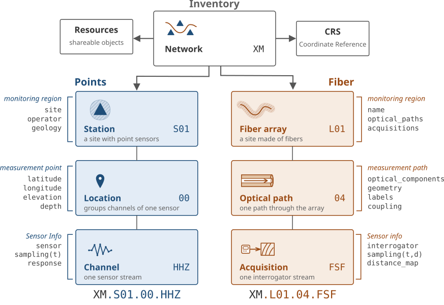
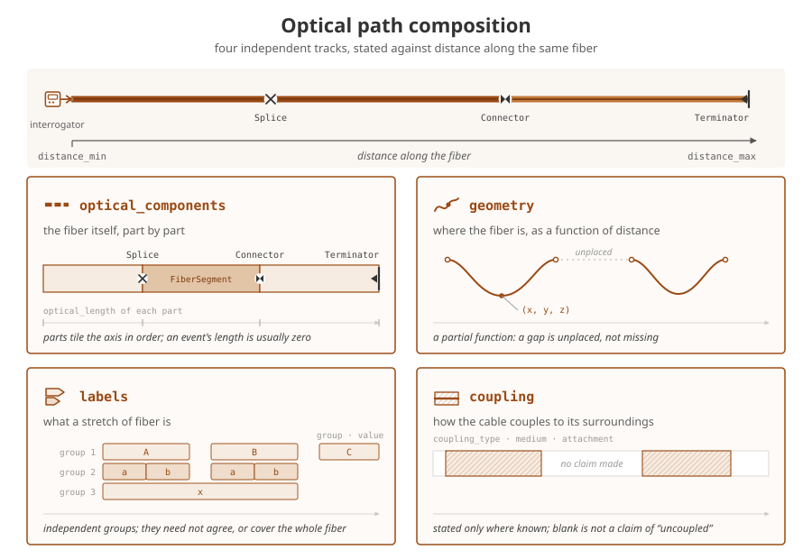



A DASDAE **inventory** describes the observing system behind a fiber archive: the optical path, interrogator settings, deployment geometry, coupling, and labels. It plays the role StationXML plays for point sensors while leaving the data files unchanged.

Patches join to the inventory through `acquisition_key` (`network.fiber_array.location.acquisition`) and time. The result is metadata: patch attributes, coordinates along the fiber, and names available for selection and grouping.

# The model

{width="100%" style="background-color: white" fig-alt="Conceptual comparison of observing-system identifiers: point sensors progress from network and station through location to channel, while fiber systems progress from network and fiber array through optical path to acquisition; both share resources and a coordinate reference system."}

The diagram compares concepts with StationXML; it is not a containment diagram. In DASCore, acquisitions and optical paths are sibling collections on a fiber array. There is no `Location` model: a [`Channel`](`dascore.core.inventory.Channel`) carries a `location_code`, and a station holds its channels directly.

An [`Inventory`](`dascore.core.inventory.Inventory`) contains [`Network`](`dascore.core.inventory.Network`) objects. A network may hold conventional stations and [`FiberArray`](`dascore.core.inventory.FiberArray`) objects. Each fiber array holds:

- [`Acquisition`](`dascore.core.inventory.Acquisition`) objects, which describe an interrogator stream and map acquisition distance onto an optical path.
- [`OpticalPath`](`dascore.core.inventory.OpticalPath`) objects, which describe what the light travelled through.

Shared objects such as interrogators, cables, enclosures, and measurements live under `Inventory.resources`. Other objects refer to them by `resource_id`; model constructors also accept the object itself.

{width="100%" style="background-color: white" fig-alt="Four tracks share optical distance: contiguous optical components tile the complete fiber, geometry is a partially defined function, labels form independent interval groups, and coupling is stated only where known."}

An optical path has four independent tracks along optical distance:

- `optical_components`: fiber segments, splices, connectors, amplifiers, and terminators. These tile the complete path and define its extent.
- `geometry`: measured quantities along the fiber, including coordinates named by the inventory's coordinate reference system.
- `coupling`: how each interval of cable meets its surroundings.
- `labels`: interval names such as borehole, drift, or zone.

Geometry, coupling, and labels may cover only part of the path. Missing coverage means “not stated,” not that the fiber or channel is absent.

Acquisitions and optical paths may have time-bounded epochs, so hardware or geometry can change while the fiber array keeps its identity. Resolving a patch therefore uses both its acquisition key and time.

# Authoring an inventory

An inventory can be one YAML or JSON document, but a directory is easier to maintain: models use YAML or JSON, and long tracks use CSV.

```text
inventory/
├── inventory.yaml
├── resources/
│   └── interrogator-1.yaml
├── acquisitions/
│   └── DAS.R2D1..RAW.yaml
└── fiber_arrays/
    └── DAS.R2D1/
        ├── attrs.yaml
        └── path/
            ├── attrs.yaml
            ├── optical_components.csv
            ├── geometry.csv
            ├── coupling.csv
            └── labels.csv
```

Each object file declares its `object_type`. An acquisition's filename gives its full identity, and its `distance_map` maps the interrogator's distance axis onto optical distance. Track files are CSV tables with one row per component or interval; a segment states `distance_min` and `distance_max`, and a point component, such as a splice, leaves `distance_max` blank. Rows are ordered by distance when loaded. The [tunnel inventory recipe](../recipes/tunnel_inventory.qmd) builds a complete directory, including resources, geometry, repairs, and multiple optical paths.

Authoring rules:

- File and directory names state identity. If the file repeats an identity field, the values must agree.
- `path` is the reserved optical-path directory. `attrs` and `inventory` are reserved file stems.
- Files outside reserved slots are ignored unless they declare a recognized inventory object, so field notes and photographs may live in the tree; files inside reserved slots must follow the conventions.
- CSV columns beginning with `_` are ignored. Use `description` for notes that should survive serialization.
- Quantities that interpolate belong in `geometry.csv`; interval values belong in `labels.csv`. Units may appear in geometry headers, for example `chainage (m)`.

An `@time` suffix, such as `path@2025-01-01/`, begins a new epoch. [`dc.inventory`](`dascore.core.inventory_loader.inventory`) validates identities, object types, references, track coverage, and epoch ranges when it reads the directory.

## Starting from the command line

`python -m dascore inventory init <directory>` writes a minimal directory: one network, fiber array, acquisition, optical path, interrogator, and cable, with every value a placeholder to replace. It refuses a directory that already holds files.

`python -m dascore inventory check <directory>` loads a directory with the same loader and prints a one-line summary when it is valid; otherwise it prints the loader's message, which names the file and field at fault, and exits with status 1.

Position is ordinary geometry whose column names match the coordinate reference system, or the canonical aliases `x`, `y`, and `z`. Positional axes must be stated together and use the CRS units; a geometry segment may omit all of them and record another quantity such as chainage instead. Fiber gathered at one place, such as a spool, is a segment of two rows with the same position at the spool's start and end distances. Segments that place the axes may not overlap in optical distance.

# Track semantics

Tracks use three shapes:

| shape | tracks | coverage | overlap | value outside coverage |
|---|---|---|---|---|
| tiling | `optical_components` | complete | none | — |
| function | geometry columns, coupling, labels with values | partial | none | `""` or `NaN` |
| membership | labels without values | partial | allowed | `False` |

Every label names its `group`, the coordinate it becomes. A label with an empty `value` states membership; one with a value defines an interval coordinate. Literal `true` and `false` values are refused, since an empty value already means membership. A group holds only text, only numbers, or only membership. Numeric groups use `NaN` outside coverage, so they project as floating-point coordinates.

Intervals are half-open, `[start, end)`, so adjacent rows tile without overlap; projection still includes the final channel of a covered run.

Geometry columns, label groups, and typed tracks become coordinates. Label group names cannot use structural names, track names, or recognized coordinate labels; see `RESERVED_GROUP_NAMES` in `dascore.core.inventory`. Geometry columns may use coordinate labels—that is how a segment states an axis—but cannot share a name with a label group.

# Inspecting and visualizing

The examples use an inventory and patch that resolve together:

```{python}
import tempfile
from pathlib import Path

import dascore as dc
from dascore.examples import inventory_patch_pair
from dascore.exceptions import PatchError

patch, inventory = inventory_patch_pair()
```

[`Inventory.get_names`](`dascore.core.inventory.Inventory.get_names`) separates scalar attributes from per-channel coordinates:

```{python}
names = inventory.get_names()
assert "gauge_length" in names.attrs
assert {"zone", "noisy", "coupling"} <= set(names.coords)
```

This lists what the inventory *can* contribute; on a partially covered path, some channels get a blank value.

`Inventory.viz.path` aligns acquisitions, components, coupling, labels, and geometry along optical distance:

```{python}
inventory.viz.path(show=True);
```

Use `tracks=` to select lanes and `columns=` to select geometry columns. [`Inventory.viz.map`](`dascore.viz.inventory.map_path`) plots geometry in space, while [`Inventory.viz.timeline`](`dascore.viz.inventory.timeline`) plots acquisition and path epochs through time.

# Using an inventory with a spool

[`Spool.attach_inventory`](`dascore.core.spool.Spool.attach_inventory`) stores a reference to an inventory without changing patches or loading data. `conform_to_inventory` uses the attached inventory; `enrich` uses it too, or attaches one it is given.

```{python}
spool = dc.spool(patch).attach_inventory(inventory)
assert "gauge_length" not in dict(spool[0].attrs)
```

Once attached, inventory coordinates can drive selection and expansion:

```{python}
northern = spool.select(zone="north")
zones = spool.expand_by("zone")
assert set(zones.get_contents()["zone"]) == {"north", "south"}
```

Selection trims channels, and a patch with no matching channels drops out silently. `unselect` removes the matching channels instead, so it can cut one patch into several pieces:

```{python}
quiet = spool.unselect(noisy=True)
assert len(quiet) == 2
```

Selection and expansion judge whole patches, so they also drop a patch that no single inventory context describes: one straddling an acquisition or optical-path change, reaching outside every optical-path epoch, or not described at all. Each call warns once with the number dropped; `unselect` keeps them. To select within such patches, [conform the spool](#conforming-a-spool) first. Selecting on an inventory-backed attribute such as `gauge_length` behaves the same, unless the patch states it in its own header.

Attaching a replacement inventory clears enrichment configured from the old one.

## Enriching patches

[`Spool.enrich`](`dascore.core.spool.Spool.enrich`) copies resolved metadata as patches are loaded. Acquisition and interrogator facts become attributes; optical-path facts become per-channel coordinates.

```{python}
enriched = spool.enrich()[0]
assert enriched.attrs.gauge_length == 10.0
assert "zone" in enriched.coords.coord_map
assert set(enriched.get_array("coupling")) == {"trench", ""}
```

The acquisition's `distance_map` places channels on the optical path. Compatible distance units are converted; incompatible axes raise. With two or more control points, channels outside the map's range are not placed. With one, the map extends both ways: by `spatial_interval` per channel on the `channel` axis (which therefore needs `spatial_interval`), or one meter per meter on the `acquisition_distance` axis. Channels not placed, or placed beyond the path's ends, get `NaN` (or empty text) from its tracks without a warning, as is normal when an interrogator records past the end of the fiber. An unresolved patch is returned unchanged with a warning, so enrichment never silently removes data.

By default, scalar acquisition and `interrogator.*` fields become attributes, and geometry, coupling, and labels become coordinates. Position coordinates take the names the inventory's coordinate reference system declares, such as `easting`, `northing`, and `elevation`, or `x`, `y`, and `z` under the default CRS; either spelling can be requested. Four fields are left out unless requested: `data_type` and `data_units`, because processing may have changed the data, and `sample_rate` and `spatial_interval`, which the patch coordinates already state.

Unset attributes are always filled. When a patch attribute conflicts with the inventory, `conflict` decides: `raise` (default), since a conflict usually means the patch resolved to the wrong acquisition; `keep_first` keeps the patch value, `keep_last` uses the inventory, and `drop` removes both.

```{python}
stale = patch.update_attrs(gauge_length=99.0)
try:
    stale.enrich(inventory)
except PatchError as err:
    print(err)
assert stale.enrich(inventory, conflict="keep_first").attrs.gauge_length == 99.0
assert stale.enrich(inventory, conflict="keep_last").attrs.gauge_length == 10.0
```

[`Patch.enrich`](`dascore.proc.inventory.enrich`) does the same for one patch, but raises on an unresolved patch.

## Conforming a spool

[`Spool.conform_to_inventory`](`dascore.core.spool.Spool.conform_to_inventory`) resolves every row now, splits patches at optical-path changes, and by default raises on unresolved patches. Because it can remove, split, or reject data, it runs only when asked; attaching and enriching never change the spool's length.

```{python}
stranger = dc.get_example_patch("random_das", acquisition_key="XX.NOPE..RAW")
mixed = dc.spool([patch, stranger]).attach_inventory(inventory)

conformed = mixed.conform_to_inventory(on_unresolved="ignore")
assert len(conformed) == 1
assert conformed[0].attrs.acquisition_key == "DAS.R2D1..RAW"
```

Splitting keeps every sample exactly once. A patch with any sample outside every acquisition epoch, or outside every optical-path epoch at its location, is unresolved as a whole rather than cut; an acquisition whose location never has an optical path is exempt. Use `on_unresolved="warn"` or `"ignore"` when an inventory covers only part of an archive.

A patch straddling an acquisition change raises, since one patch cannot carry two acquisition configurations; select the time on each side of the change instead.

# Inventory files beside data

A spool opened on a directory attaches an inventory stored there as `.inventory/`, `.inventory.yaml`, `.inventory.yml`, or `.inventory.json`:

```{python}
data_path = Path(tempfile.mkdtemp()) / "archive"
data_path.mkdir()
patch.io.write(data_path / "patch.h5", "DASDAE")
inventory.io.to_yaml(data_path / ".inventory.yaml")

carrying = dc.spool(data_path).update()
assert carrying.enrich()[0].attrs.gauge_length == 10.0
```

The spool finds the file when it opens but parses it only for an inventory-backed operation, such as selecting on an inventory coordinate, then caches it; `len`, sorting, chunking, loading patches, and selecting on indexed names do not parse it. After editing the file, call `attach_inventory()` with no argument to reread it.

Two `.inventory` spellings in one directory are refused as ambiguous. `inventory.yaml`, without the dot, is not a companion file; it is the envelope of the authoring directory.

# Serializing

[`Inventory.io.to_yaml`](`dascore.core.inventory.inventory_to_yaml`) writes the single-file form. [`dc.inventory`](`dascore.core.inventory_loader.inventory`) reads a directory, YAML, JSON, a model, or serialized text.

```{python}
text = inventory.io.to_yaml()
assert dc.inventory(text) == inventory

json_path = data_path / "inventory.json"
json_path.write_text(inventory.model_dump_json())
assert dc.inventory(json_path) == inventory
```

Invalid documents raise [`InvalidInventoryError`](`dascore.exceptions.InvalidInventoryError`).
